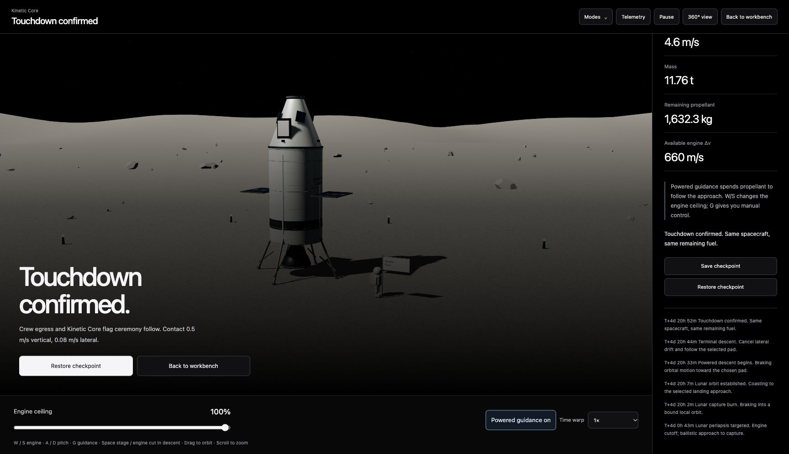

# Kinetic Core

**Design a mission. Fly its critical moments.**

> **Development archive.** The author-owned publication repository is **[Kinetic-Core-2026](https://github.com/ropotropo/Kinetic-Core-2026)**. This archive stays available for the original submitted PDF, historical sources and its existing playable.

Created by **Mykyta Borisov** · **NASA Space Apps Challenge 2026** · Challenge: **Space Mission Design Game**

Build a modular spacecraft, see how engineering choices change its performance, and fly a continuous Earth-to-Moon landing mission. Practice docking and surface landings as clearly separate exercises.

## Start here

| Review material | Link |
| --- | --- |
| Publication game | **[Open Kinetic Core](https://ropotropo.github.io/Kinetic-Core-2026/)** |
| Archive game | [Existing submitted/archive playable](https://ropotropo.github.io/Hakaton2026/kinetic-core/) |
| Submitted presentation | **[English PDF — original submitted link](https://github.com/ropotropo/Hakaton2026/blob/codex/final-presentations/presentation/Kinetic-Core-EN.pdf)** |
| Project guide | **[Read the Wiki](https://github.com/ropotropo/Hakaton2026/wiki)** |
| Gameplay video | **[Video and update status](VIDEO.md)** — completed film, maintained separately |
| Portable game and preview installers | [v0.4.4 downloads](https://github.com/ropotropo/Hakaton2026/releases/tag/v0.4.4) |

**Current game: v0.4.4, a development preview.** The PDF keeps its original URL and bytes. Video revisions use one stable file path; they do not change this game's version.



*Recorded gameplay from the documented guided Moon-mission check. This image is historical test evidence, not a new run of the final build.*

## Try the first mission

1. Open **Modes → Rocket workshop** and load the **Lunar demonstrator**.
2. Choose **Start Flight → Moon**, select an approach and start the mission.
3. Keep **Powered guidance** on initially. Separate depleted stages when prompted and use time warp for long coasts.

For a quick maneuver, choose **Modes → Manual docking** or **Modes → Surface landing**. See [How to play](docs/GETTING-STARTED.md) for controls, checkpoints and recovery.

## What the prototype demonstrates

- The same assembled spacecraft carries its mass, finite propellant and flight state through Earth launch, staging, orbit, lunar departure, capture and touchdown.
- Dimensions and hardware choices change mass, thrust, fuel and performance. Powered guidance and RCS assistance spend the available propellant.
- A separate manual docking exercise offers external, docking and cockpit cameras. Other-world surface rehearsals explicitly skip interplanetary transfers.

The mission model uses **2D patched conics, ideal engine pointing and a synthetic circular Moon epoch**. Terrain and spacecraft are illustrative. Sampling, lunar ascent, return and complete interplanetary transfers are future work. Desktop keyboard is the primary precision-control baseline; real-phone performance and Windows/Android device acceptance remain unverified.

## Evidence and source

[Current scope and verification](docs/CURRENT-VERSION.md) · [Physics and references](docs/PHYSICS.md) · [Documentation index](docs/README.md) · [Presentation materials](presentation/README.md) · [Archive/publication continuity](docs/MIGRATION.md)

The current numerical suite contains **86 tests**. Build checks and historical browser evidence are identified separately in the documentation; a passing suite is not certification or a universal accuracy score.

To run locally with Node.js **22.12+** and npm:

```sh
npm ci
npm test
npm run build
npm run preview
```

For a portable copy, download `Kineti-Core.html` from the [v0.4.4 release](https://github.com/ropotropo/Hakaton2026/releases/tag/v0.4.4) and open the downloaded file. The legacy filename is retained for compatibility. The core Moon game has bundled assets; optional online Earth flight needs internet. Browser saves stay local to the current origin and device.

## Authorship and credits

**Mykyta Borisov is the sole game author.** Andrii relays feedback and coordinates development; Codex and specialist agents provide implementation, design and verification assistance. See [AUTHORS.md](AUTHORS.md).

NASA/JPL/USGS references and imagery retain their [source credits](public/assets/SOURCES.md). Dependency licenses are included in [THIRD_PARTY_NOTICES.txt](dist/THIRD_PARTY_NOTICES.txt). Generated cover artwork is documented separately from actual gameplay. No NASA affiliation or endorsement is implied. A new public license for the original game has not been selected; third-party license terms continue to apply.
